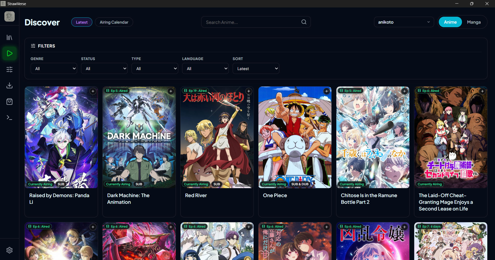
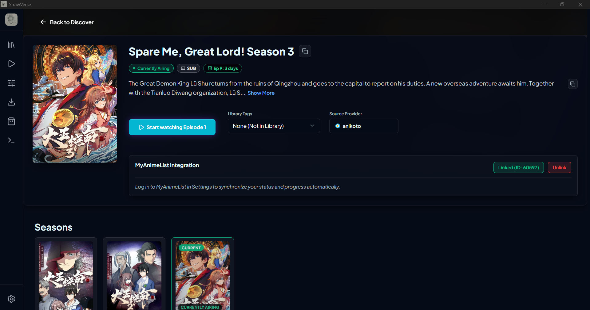
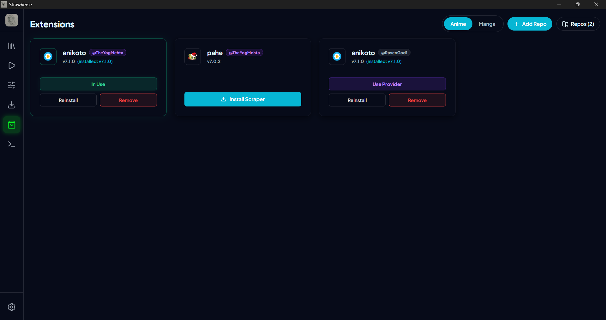
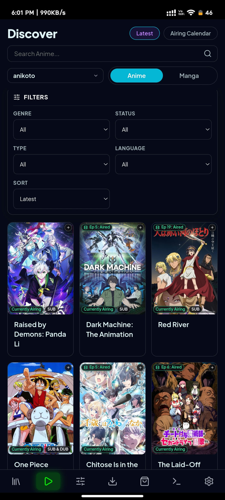
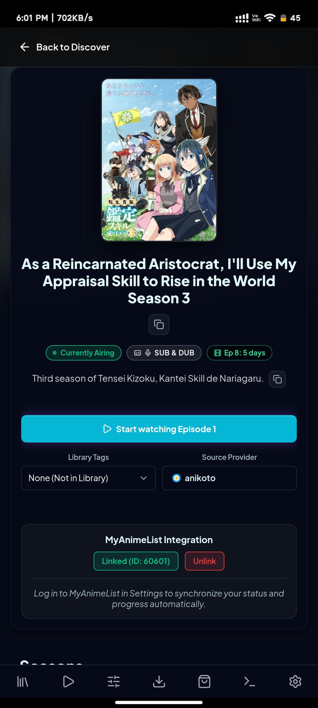
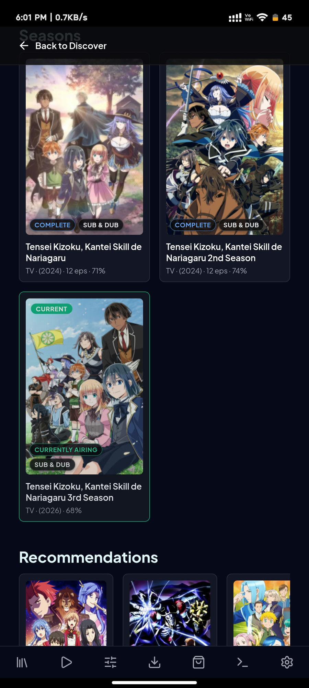

<h6 align="right">Supports Android, Windows, Linux & macOS</h6>
<h1 align="center">
  
</h1>

# StrawVerse

> **A fast, open-source anime and manga downloader for Windows, Linux, macOS, and Android with batch downloads, subtitles, multiple sources, quality selection, and MyAnimeList integration.**

<p align="center">
  <a href="https://github.com/RavenGod1/StrawVerse/releases">
    
  </a>
  <a href="https://github.com/TheYogMehta/StrawVerse/stargazers">
    
  </a>
  <a href="https://github.com/RavenGod1/StrawVerse/blob/main/LICENSE">
    
  </a>
  <a href="https://discord.gg/PzfUBgQ2gt">
    
  </a>
</p>

> [!NOTE]
> **This repository is a community fork** of [TheYogMehta/StrawVerse](https://github.com/TheYogMehta/StrawVerse), continuing development as **v11.2.2** (upstream is at v11.2.1). Releases and issue tracking for this build live here; the original project is linked throughout for credit.

StrawVerse is a fast, open-source **anime downloader** and **manga downloader** designed for Windows, Linux, macOS, and Android. Built for speed, versatility, and offline media management, StrawVerse enables you to search, stream, read, and perform **batch anime downloads** and manga chapter downloads across multiple high-speed sources.

Whether you want high-speed **anime download** queues in 1080p, full Sub and Dub subtitle extraction, or automatic MyAnimeList synchronization, StrawVerse brings your entire **anime & manga** library together under one powerful open-source platform.

<p align="center">
  <a href="https://github.com/RavenGod1/StrawVerse/releases"><b>Download StrawVerse</b></a> • 
  <a href="https://strawverse.theyogmehta.online"><b>Official Website</b></a> • 
  <a href="https://discord.gg/PzfUBgQ2gt"><b>Join Community Discord</b></a>
</p>

---

## 📥 Quick Download

All fork builds are published on the [Releases page](https://github.com/RavenGod1/StrawVerse/releases) of this repository:

| Platform    | File                                        | Format                          | OS Compatibility                      |
| :---------- | :------------------------------------------ | :------------------------------ | :------------------------------------ |
| **Windows** | `StrawVerse.Setup.<version>.exe`            | Installer (`.exe`)              | Windows 10, 11 (64-bit)               |
| **Android** | `app-release.apk`                           | Mobile APK (`.apk`)             | Android 7.0+                          |
| **Linux**   | `strawverse-<version>.AppImage`             | Portable (`.AppImage`)          | Ubuntu, Debian, Arch, Fedora          |
| **Linux**   | `strawverse_<version>_amd64.deb`            | Debian/Ubuntu package (`.deb`)  | Debian, Ubuntu and derivatives        |
| **macOS**   | `StrawVerse-<version>-mac-arm64.zip`        | Application (`.zip`)            | macOS 12+ (Apple Silicon M1–M4)       |

> [!NOTE]
> **macOS (Apple Silicon) First Launch:** this build is unsigned (ad-hoc community release), so Gatekeeper may ask you to confirm opening the app on first launch. Right-click `StrawVerse.app` in `/Applications` and select **Open**, or run:
>
> ```bash
> xattr -cr /Applications/StrawVerse.app
> ```

---

## 🎉 What's New in This Fork (v11.2.2)

- **Mapping sync no longer aborted by one bad table:** a single provider table returning HTTP 500 (currently the server-side `animesalt` table) used to block *all* mapping tables from syncing. The sync now falls back to core tables first (`anime`, `manga`, `next_episodes` + unmapped), then each provider individually — only the broken table is skipped.
- **Faster startup:** the auto-update check is deferred by 8 seconds, image-cache cleanup batches its deletes, and snapshot apply drops 80k+ per-row queries.
- **Info page Seasons now include `OVA`, `MOVIE`, and `SPECIAL`** — not just TV series.
- **Repository enable/disable:** toggle extension repositories on/off; disabled repos hide while installed items stay.
- **Discover provider switcher:** provider picker next to the Anime/Manga toggle; clears caches and reloads page 1.
- **Description copy button** on title pages (copies the full raw text).
- **Plex & Jellyfin** settings section before Subtitle Customization & Appearance.
- **Android fixes:** dead Browse button (missing `Swal` import) and hidden provider picker (gate relaxed to `>= 1`).
- Merged upstream **v11.2.1 / v11.2.0** work (manga reader overhaul, mapping/Manga schema fixes, Cloudflare cookie fixes).

Full history: [changelog.md](changelog.md) • upstream releases: [TheYogMehta/StrawVerse](https://github.com/TheYogMehta/StrawVerse/releases)

---

## ✨ Features

- **Batch Anime Episode Downloads:** Download complete anime series, seasons, or selected episodes in bulk with parallel queue processing.
- **Manga Chapter Downloads:** Download manga volumes and chapters into CBZ format or structured image directories for offline reading.
- **Fast Parallel Engine:** Multi-threaded download acceleration optimized for minimum wait times and max bandwidth usage.
- **Multiple Video Qualities:** Seamless quality selection (360p, 480p, 720p, 1080p FHD) with automatic resolution fallback.
- **Sub & Dub Support:** Full access to Japanese audio streams with subtitles (Sub) and English Dubbed anime releases.
- **Flexible Subtitle Handling:** Extract soft subtitles as raw `.vtt` / `.ass` files or merge them directly into `.mp4` containers.
- **In-App Player & Reader:** Stream anime directly with a built-in HTML5 video player or read manga with customizable layouts.
- **MyAnimeList Integration:** Authenticate via MAL OAuth to automatically track watched episodes, read chapters, and sync lists.
- **Cross-Platform Support:** Unified desktop and mobile client experience across Windows, Linux, macOS, and Android.
- **Free & Open Source:** 100% community-driven under GPL-3.0 without advertisements or locked features.

---

## Showcase

**Desktop**

| | | |
| :---: | :---: | :---: |
|  |  |  |

<p align="center">━━━━━━━━━━━━━━━━━━━━━━━━━━━━━━━━━━━━━━━━━━━━━━━</p>

**Android**

| | | |
| :---: | :---: | :---: |
|  |  |  |

---

> [!IMPORTANT]
> **Legal Disclaimer:** StrawVerse is an open-source local media manager and indexing application designed for developers and researchers. The developers of this application do not host, store, stream, or distribute any copyrighted media (video, audio, or images). The application functions solely as a client-side parser and downloader wrapper utilizing publicly available web resource links. We do not condone, promote, or encourage copyright infringement. By using this software, you acknowledge and agree that all download and media-access activities are conducted at your own risk and responsibility, and that you are solely responsible for ensuring compliance with all local, national, and international copyright laws and terms of service.

## 📑 Table of Contents

- [Overview](#-overview)
- [Key Features](#-key-features)
- [System Requirements](#system-requirements)
- [Installation](#installation)
- [Usage](#-usage)
- [Videos](#videos)
- [Configuration](#-configuration)
- [Uninstalling the Application](#uninstalling-the-application)
- [Build the Application](#build-the-application)
  - [Prerequisites](#prerequisites)
  - [Steps to Build](#steps-to-build)
  - [Desktop — Windows](#desktop--windows)
  - [Release Artifacts](#release-artifacts)
- [Build and Run the Android Application](#build-and-run-the-android-application)

---

## 🌟 Overview

**StrawVerse** is a cross-platform application built with Electron, Capacitor, React, and Vite that allows you to stream, read, download, and track your anime and manga collections. It uses a local SQLite database to manage your library and watch history.

Beyond standard downloading, StrawVerse includes real-time playback synchronization with friends (Watch Together), automatic MyAnimeList synchronization, a built-in media player, and a manga reader.

---

## 🚀 Key Features

- **Watch Together:** Host or join rooms to watch anime synchronously with friends (includes shared queue and text chat).
- **In-App Player & Reader:** Stream anime directly or read manga chapters in the app. Remembers your playback position and layout preferences.
- **Bulk Downloading:** Download entire seasons of anime or manga volumes at once, with support for merging subtitles directly into video files.
- **Library Tracker:** Tracks your progress (time watched, chapters read) and automatically updates your MyAnimeList account.
- **Discord Status:** Shows your current show or manga on your Discord profile.

---

## System Requirements

- **Operating System:** Android, Windows, Linux & macOS

## Installation

### For macOS (Apple Silicon M1/M2/M3/M4)

1. Go to [StrawVerse Releases](https://github.com/RavenGod1/StrawVerse/releases).
2. Download `StrawVerse-<version>-mac-arm64.zip`.
3. Unzip the downloaded archive and drag `StrawVerse.app` into your `/Applications` folder.
4. **First Launch (Gatekeeper bypass):** because this build is unsigned, macOS may show a developer verification notice on first launch:
   - **Option 1 (Right-click):** Right-click (or Control-click) `StrawVerse.app` in `/Applications`, select **Open**, and then click **Open** on the confirmation prompt.
   - **Option 2 (Terminal):** Clear the quarantine attribute by running:
     ```bash
     xattr -cr /Applications/StrawVerse.app
     ```

### For Windows

1. Go to [StrawVerse Releases](https://github.com/RavenGod1/StrawVerse/releases).
2. Download the setup file `StrawVerse.Setup.<version>.exe`.
3. Run the installer to install the application, and enjoy!

### For Linux

1. Go to [StrawVerse Releases](https://github.com/RavenGod1/StrawVerse/releases).
2. Download the AppImage `strawverse-<version>.AppImage` or the deb package `strawverse_<version>_amd64.deb`.
3. For AppImage: make it executable using `chmod +x strawverse-<version>.AppImage` and run it.
4. For deb: install it with `sudo apt install ./strawverse_<version>_amd64.deb`.

### For Android

1. Go to [StrawVerse Releases](https://github.com/RavenGod1/StrawVerse/releases).
2. Download the APK file `app-release.apk`.
3. Open and install the APK on your Android device!

## 📖 Usage

1. Run the application (`StrawVerse.exe` on Windows, `StrawVerse.app` on macOS, or `strawverse-<version>.AppImage` on Linux).
2. **Search and Discover:** Use the unified Discover page to search across anime or manga, switching search modes with the header toggle slider.
3. **Stream or Read:** Select a title to watch instantly in the custom HTML5 video player, or read chapters in the built-in manga reader.
4. **Synchronized Playback:** Jump to the **Watch Together** tab to host or join a synced watch room with friends.
5. **Bulk Download:** Select episodes/chapters from the detail view, choose your format (Sub/Dub/HSUB), and track queues in the Downloads tab.

## Videos

### How to download and use `StrawVerse.exe`?

[](https://www.youtube.com/watch?v=ZmcE-LrofgQ)

https://github.com/user-attachments/assets/9042f0f9-be25-4705-a6a5-dace3a3539e0

## 🔧 Configuration

Navigate to the settings tab to configure your StrawVerse application:

1. **MyAnimeList Integration:** Authenticate your MAL account via OAuth to enable plan-to-watch/plan-to-read automatic list tracking.
2. **Player Settings:** Configure subtitle styling and downloading preferences. Hianime provider streams support subtitle track extraction—choose to save subtitle tracks as raw external files or merge them directly into the output MP4 container.
3. **Quality Preferences:** Customize preferred resolution fallbacks for scrapers.
4. **Server & Mapping URL:** Reset or configure the address of the central mapping server. Verify connection endpoints with the integrated health test control.
5. **Storage & Cache:** Set size limits for poster image disk caching (default 5GB). The app implements LRU cache eviction and automatically purges cached assets older than 6 days.

## Uninstalling the Application

### For macOS

1. Drag `StrawVerse.app` from your `/Applications` folder to the **Trash** (and empty Trash).
2. _(Optional)_ To completely delete application settings and local cache:
   ```bash
   rm -rf ~/Library/Application\ Support/strawverse
   ```

### For Windows

To delete the application, navigate to the following directory:

```
C:\Users\USERNAME\AppData\Local\Programs\StrawVerse
```

Then, run `Uninstall StrawVerse.exe`.

### For Linux

- **AppImage:** Simply delete the downloaded `.AppImage` file.
- **DEB Package:** Run the following command in your terminal:
  ```bash
  sudo apt remove strawverse
  ```
- _(Optional)_ To delete application configuration and local database files:
  ```bash
  rm -rf ~/.config/strawverse
  ```

---

# Build the Application

## Prerequisites

1. **Download and install Node.js**:
   - [Node.js Download](https://nodejs.org/)

2. **Download and install Git**:
   - [Git Download](https://git-scm.com/)

3. **Download and install Python**
   - [Python Download](https://www.python.org/downloads/)

4. **C++ Build Tools (Windows only, required for compiling native SQLite node modules via node-gyp)**
   - During the Node.js installation on Windows, make sure you check the box that says **"Automatically install the necessary tools"** (this installs Python and the necessary VS Build Tools via Chocolatey automatically).
   - Alternatively, you can manually download and install **[Visual Studio Build Tools](https://visualstudio.microsoft.com/visual-cpp-build-tools/)** (be sure to select the **Desktop development with C++** workload during setup).

## Steps to Build

1. Clone this repository:

   ```bash
   git clone https://github.com/RavenGod1/StrawVerse.git
   ```

2. Navigate to the Electron project and install dependencies (this also fetches the mpv/ffmpeg binaries and builds native modules):

   ```bash
   cd StrawVerse/electron
   npm install
   ```

3. Build the GUI bundle (Vite production build):

   ```bash
   npm run build
   ```

4. Run the application for testing:

   ```bash
   npm start
   ```

## Desktop — Windows

From `StrawVerse/electron`:

```bash
npx electron-builder --win
```

Output: `electron\dist\StrawVerse.Setup.<version>.exe`

> [!WARNING]
> `npm run package` (and `package:mac` / `package:all`) **delete the entire `electron\dist` folder first**, and their Linux targets cannot run on Windows. Prefer the direct `npx electron-builder --win` command above when other artifacts in `dist` must survive.

## Release Artifacts

| Artifact                              | Built by                       | Output directory                                   |
| :------------------------------------ | :----------------------------- | :------------------------------------------------- |
| `StrawVerse.Setup.<v>.exe`            | `npx electron-builder --win`   | `electron\dist\`                                   |
| `strawverse-<v>.AppImage`             | `electron-builder --linux --x64` | `electron\dist\`                                 |
| `strawverse_<v>_amd64.deb`            | `electron-builder --linux --x64` | `electron\dist\`                                 |
| `StrawVerse-<v>-mac-arm64.zip`        | `electron-builder --mac --arm64` | `electron\dist\`                                 |
| `app-release.apk`                     | `npm run build:android`        | `capacitor\android\app\build\outputs\apk\release\` |

The release manifest [`latest.yml`](latest.yml) in the repository root records the exact **size + SHA512** of every published artifact — update it after any rebuild.

---

# Build and Run the Android Application

## Prerequisites

1. **Android SDK / Android Studio** installed.
2. A connected **Android device** (with USB Debugging enabled) or an **emulator** running.
3. Node.js & npm installed.

## Steps to Build and Run

1. **Install Dependencies** (one-time):

   In the repository root:

   ```bash
   npm install
   ```

   Then install the Capacitor project's dependencies:

   ```bash
   cd capacitor
   npm install
   cd ..
   ```

2. **Sync Android Project** (builds the GUI, bundles the backend, and syncs with Capacitor) — from the repository root:

   ```bash
   npm run sync:android
   ```

3. **Build Android APK** — from the repository root:

   ```bash
   npm run build:android
   ```

   _(Outputs a signed release APK to `capacitor/android/app/build/outputs/apk/release/app-release.apk`)_

4. **Run the Application**:
   - **Option A**: Directly from the terminal:
     ```bash
     npx cap run android
     ```
   - **Option B**: Using Android Studio:
     ```bash
     npx cap open android
     ```

## Repository Scripts Reference

| Script (repository root)   | What it does                                                    |
| :------------------------- | :-------------------------------------------------------------- |
| `npm run start:desktop`    | Builds the GUI, then launches Electron for development          |
| `npm run build:gui`        | Vite production build of the GUI (`gui/dist`)                   |
| `npm run sync:android`     | Builds the GUI and syncs the Capacitor Android project          |
| `npm run build:android`    | Syncs, then builds the signed release APK                       |

Scripts in `electron/`: `npm start` (dev run), `npm run build` (GUI bundle), `npx electron-builder --win|--linux|--mac` (packaging — see sections above).
